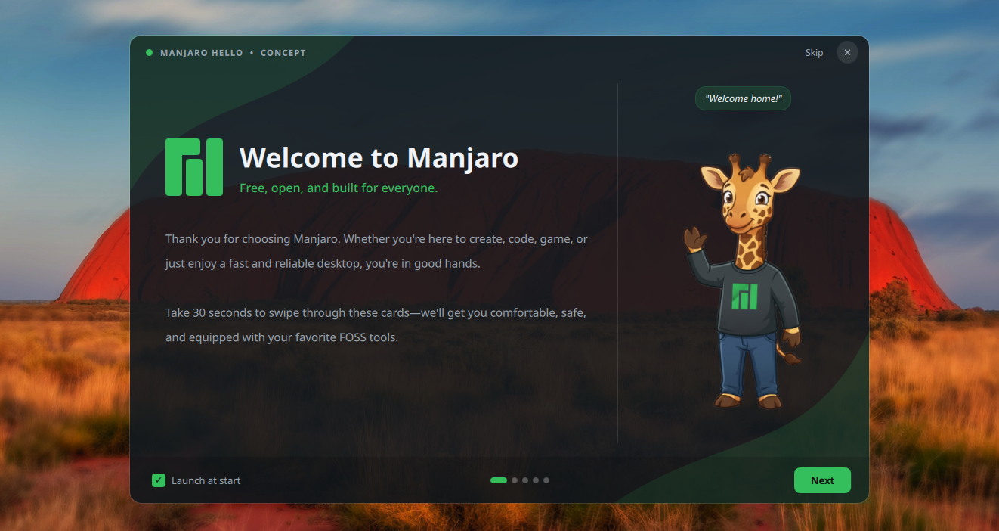
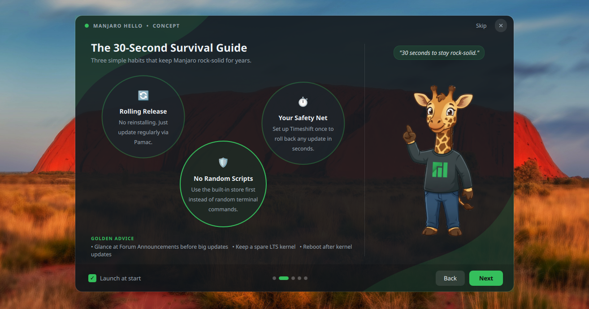
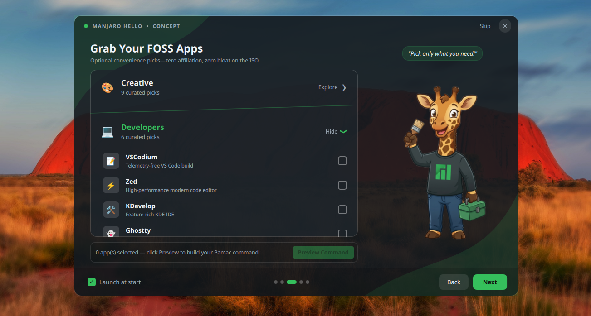
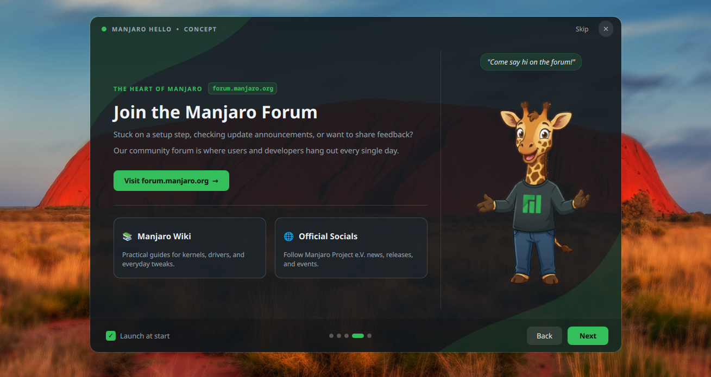
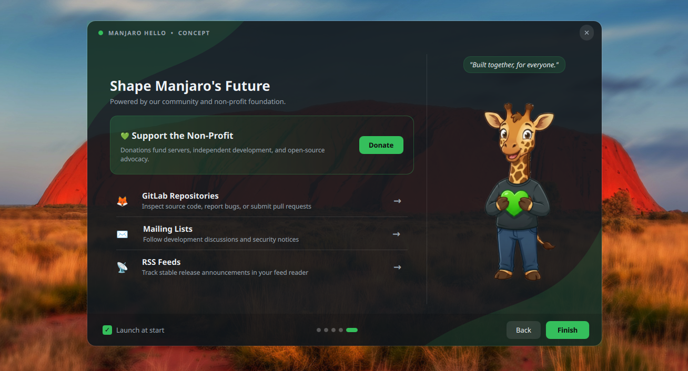
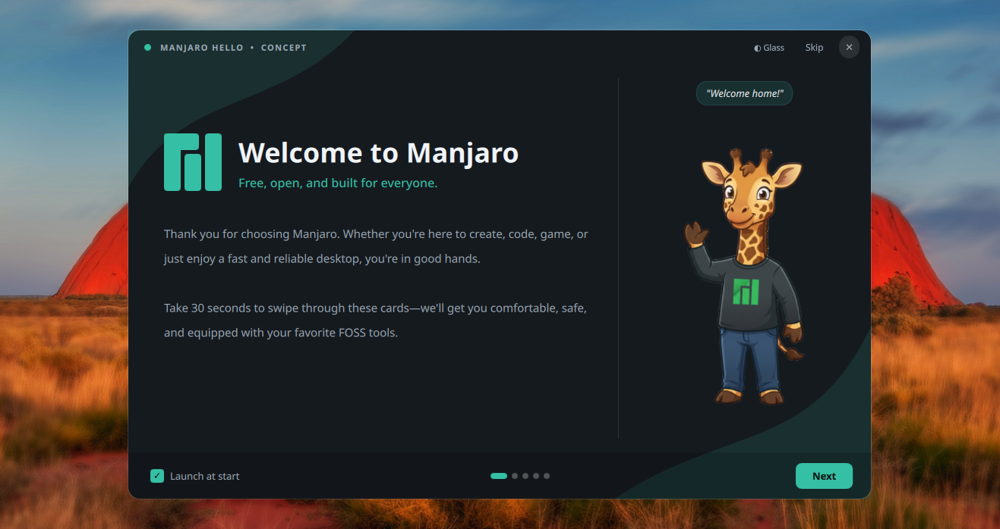

# Manjaro Hello — UI/UX Concept

A lightweight **Qt6 + QML** community concept for a modernized `manjaro-hello`, designed to welcome newcomers without bloating the ISO.
**This is an AI assisted Project**

---

## Preview



| 30-Second Survival Guide | Grab Your FOSS Apps |
| :---: | :---: |
|  |  |

| Community | Contribute & Support |
| :---: | :---: |
|  |  |



## Highlights
- **5-Card Horizontal Walkthrough:** Smooth swipe/arrow-key navigation with a frameless translucent UI.
- **30-Second Survival Guide:** Jargon-free onboarding covering Rolling Releases, avoiding random terminal scripts, and Timeshift snapshots.
- **JSON-Driven FOSS App Picker:** Non-hardcoded categories (`data/apps.json`) in a slanted accordion layout with clear *Proprietary* badges and a copyable `pamac` command preview.
- **Mascot Concept (Baby Masai Giraffe):** Manjaro is named after Mount Kilimanjaro in Tanzania—and the Masai giraffe (*Twiga*) is Tanzania's national animal. Included as a playful "Manjaro 2.0" community pitch.
- **Accessibility Toggle:** Switch cleanly between translucent Glass and Solid backgrounds from the top bar.
- **Mascot Stage:** The right 1/3rd column is a modular layout placeholder designed to showcase **Jaro** or any future community-drawn mascot.

## Quick Run (Manjaro)
```bash
sudo pacman -S --needed pyside6 noto-fonts
git clone https://github.com/AwwsmGaurav/manjaro-hello-concept.git
cd manjaro-hello-concept
python main.py
```

Or install locally via `makepkg -si` and run `manjaro-hello-concept`.

**CLI Flags**
  - `--solid` — Launches in opaque high-contrast mode by default (ideal for non-composited WMs like Openbox/Mabox or accessibility preferences).
  - `--opacity <0.2-1.0>` — Adjusts glass background translucency (default: `0.92`).
  - `--blur <0.0-1.0>` — Controls the cross-DE internal frosted diffusion layer (default: `0.65`).


## Maintainer / Packager Options
High-Contrast Solid Mode (`--solid`): Pass `--solid` to launch with an opaque background by default (recommended for lightweight window managers without compositing/blur, or for high-contrast accessibility):

```
python main.py --solid
```

Rebranding: All app categories and packages live in data/apps.json. Accent colors, logos, and stage visuals are grouped at the top of ui/Main.qml.
Local Package: Run makepkg -si to build and install locally.

## License
MIT — free to fork, rebrand, or adapt for any distribution.
